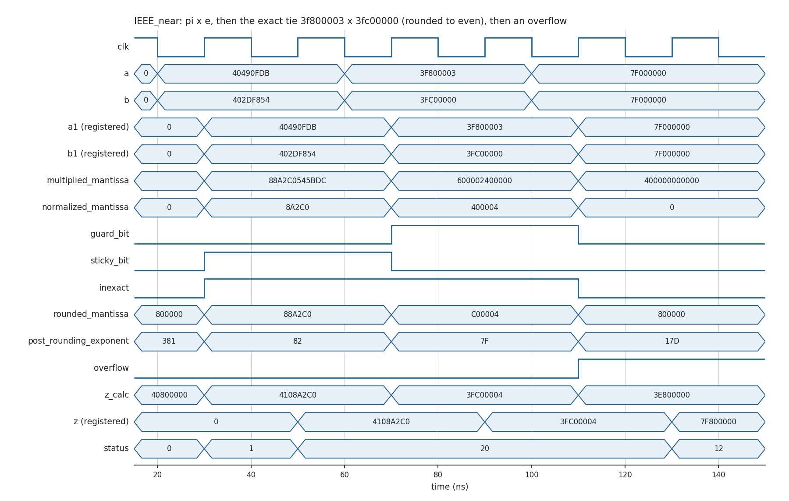

# Floating-point multiplier in SystemVerilog

An IEEE 754 single-precision floating-point multiplier with six rounding modes, status flags and exception handling, with a testbench, SystemVerilog assertions and a script that checks every product against a reference function.



## Context

Coursework for Low-level HW Digital Systems II at the School of Electrical and Computer Engineering, Aristotle University of Thessaloniki, 2023. Individual coursework. The course provided the assignment text, the wrapper `fp_mult_top.sv` and the reference function `multiplication` (`src/multiplication.sv`). The design, the testbench and the assertions were written for the assignment.

The report is in [docs/report.md](docs/report.md) and the assignment in [docs/brief.md](docs/brief.md). The report was written in Greek and the files here are the English version; the assignment text was already in English.

## What it does

- Multiplies two 32-bit floating-point numbers (`a`, `b`) and returns the product `z` and an 8-bit `status` word (zero, infinity, invalid, tiny, huge, inexact).
- Supports six rounding modes, chosen by the parameter `round`: `IEEE_near` (to nearest, ties to even), `IEEE_zero`, `IEEE_pinf`, `IEEE_ninf`, `near_up` and `away_zero`.
- Handles the corner cases the assignment lists: zeros, infinities, NaNs, overflow and underflow. As the assignment asks, denormals count as zero and NaNs as infinity.
- Checks itself with a testbench that runs all six rounding modes side by side, and with immediate and concurrent assertions on the status bits.

## How it works

The wrapper `fp_mult_top` registers the inputs and the outputs, so a result appears two clock cycles after its inputs. Inside, `fp_mult` calculates the sign, adds the exponents and subtracts the bias, multiplies the two 24-bit mantissas, and passes the 48-bit product through `normalize_mult` (which finds the guard and sticky bits), `round_mult` and `exception_mult`. The waveform above shows these signals for three multiplications. [docs/brief.md](docs/brief.md) describes each module and the status bits.

## Getting started

### Requirements

Verilator 5 (with `--timing`), Icarus Verilog 14 and a C++ compiler for Verilator, and a POSIX shell. The tests were run with Verilator 5.055, Icarus Verilog 14.0 and GCC 16.2.0, from the OSS CAD Suite release of 2026-11-23 and w64devkit, on Windows from Git Bash.

### Build and run

```
sh tests/run_tests.sh
```

It takes about 40 seconds and ends with

```
random.txt TOTAL: 600600 compared, 0 mismatches
directed.txt TOTAL: 120 compared, 0 mismatches
all checks passed
```

Two simulators are used because neither runs the whole project: Icarus Verilog cannot build the design (it does not support `unique if`, `case ... inside` and `bind`), and Verilator evaluates the course's `shortreal` reference function wrongly. So Verilator runs the design and writes every input and output to a file, and Icarus Verilog evaluates the reference function on the same inputs and compares.

## Results

| Check | What it verifies |
|---|---|
| random | 100,000 random pairs and the 100 corner-case pairs of `src/fp_mult_tb.sv`, each in all six rounding modes: 600,600 products match the reference function |
| directed | 20 pairs that random values practically never reach: exact products, exact ties, inexact products with an even number of discarded ones, zero, denormal, infinity and NaN operands, an underflow and an overflow; 120 products match the reference function |
| status | eight of the directed pairs also check the exact `status` word |

Running the original testbench `src/fp_mult_tb.sv` in Verilator gives no assertion failure: 25,225,620 immediate and 9,009,120 concurrent assertion checks pass. Its own comparison with the reference function is not meaningful there, for the reason given above.

## Project structure

```
src/
  main.sv, normalization.sv, rounding.sv, exception.sv    fp_mult and its three sub-modules
  fp_mult_top.sv                                          wrapper with input and output registers (from the course)
  multiplication.sv                                       reference function (from the course)
  fp_mult_tb.sv                                           testbench: random and corner cases, six roundings
  fp_mult_assertions.sv, test_status_*.sv                 assertions bound to the wrapper
tests/
  random_tb.sv, directed_tb.sv, check_ref.sv, run_tests.sh
docs/                                                     report, assignment, figure
```

## Limitations

- Simulation only: not synthesised and not run on an FPGA.
- Not run with Questa, the tool the course used, and not tested on Linux or macOS. `src/fp_mult_tb.sv` was written for Questa.
- The `status` flags have no independent reference: the course's function checks only `z`. They are covered by the assertions and the eight directed status cases.
- For two normal operands whose exponents add up to exactly 255 the result is infinity without the `huge` flag; the assignment does not make clear whether that is intended.

## Credits and licence

The code written for the assignment is under the MIT licence (see [LICENSE](LICENSE)). The licence does not cover what the course supplied: `src/fp_mult_top.sv` and `src/multiplication.sv`, and the assignment text that `docs/brief.md` reproduces in Markdown. They belong to the course staff.
